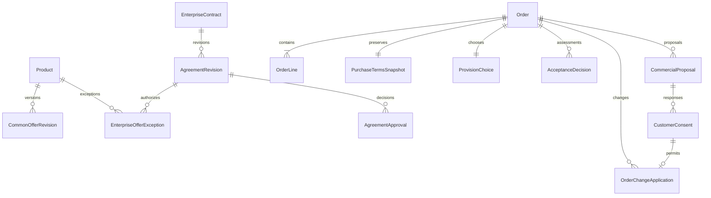

# U3 상품·계약·주문 기능 설계

## 목적과 첫 배포 범위

U3의 ProductCatalog·CommercialAgreement·OrderAcceptance에 대해 주문 가능한 상품/기업 조건, 다른 사람의 계약 승인, 같은 타입 다품목 접수, 구매 당시 조건 보존, 전체 직원 수락과 변경 동의를 설계한다. [확인한 Q&A](functional-design-questions.md)의 Q1–Q4 및 Looks correct를 적용한다.

첫 배포는 고객사10곳 이내 제한 파일럿이다. 일주문1000건은 계획 목표이며 실측 용량이 아니다. 고객/직원은 한국어 PC1280 이상, 직원은 내부망에서 접근한다. 상품은 내부 직원만 등록한다. 주문 한 건 최대100입력행, HW만 또는 SW만, 지급 종류는 PREPAY/POSTPAY 중 하나, 제공은 FULL, 수락은 전체 직원 판단이다. 소수 단가·혼합 지급·모바일·자동 확정·부분 제공 자동화·자동 갱신은 후속이다. [S1–S4]

이 문서는 **워크플로와 상태 전이의 단일 원본**이다. [entities.md](entities.md)의 YAML은 속성/관계, [rules.md](rules.md)의 YAML은 판단 규칙의 단일 원본이다. ER 도식과 규칙 요약은 파생 표시다. 설계 연결은 구현·시험·실제 배포 완료가 아니다.

## Domain Model

공통 Ref는 닫힌 owner/entity 목록의 소유자·식별자·종류·정확한 개정을 보존한다. 값 객체는 entities.md의 인라인/원본 하위 값 매핑을 따르며 그 논리 이름을 Ref.entity로 전송하지 않는다. ProductCatalog의 공통 조건과 CommercialAgreement의 기업 조건을 입력행/조건 항목별로 조회해 최초 스냅샷에 모두 고정한다. 새 계약/현재 가격을 기존 스냅샷에 덮어쓰지 않는다. 주문의 기업·부서·사업장·조직정책·조직 개정은 C00.TargetScope로 함께 보존한다.

아래 ER 도식은 엔티티 모델의 내부 관계를 줄여 표시한다. 갱신 제안의 U6 참조, 스냅샷의 공통/계약 개정 참조와 기업/신원 외부 참조는 entities.md의 관계/속성에 명시되어 있다. 실제 Mermaid parser 검증 후 기록했다.

텍스트 대체: 상품은 공통 조건 개정을, 기업 계약은 계약 개정과 승인 기록을 갖는다. 승인 개정은 기업 예외를 허용한다. 주문은 입력행·최초 스냅샷·제공 선택을 소유하고 전체 판단과 변경 기록을 누적한다. 특정 제안 개정의 고객 동의가 정확히 일치하는 주문 변경에 연결된다. 실제 대금·HW 수량·SW 실제 기간은 각각 U4/U5/U6의 원본이다.

## Business Rules

| 규칙 묶음 | 요약 |
| --- | --- |
| BR1.1–BR1.4 | 내부 직원 상품 등록, 필수 판매 정보, 기업별 공개/가격, 원 단위 단가 |
| BR2.1–BR2.7 | 합의 근거 등록, 고객 변경 요청, 다른 사람 승인, 정확한 개정, 충돌 차단, 기업 계약 우선, 이력 |
| BR3.1–BR3.8 | 입력/권한, 최초 스냅샷, 동일 요청 재확인, 전체 직원 검토, FULL, 부분 선제공 금지, 전체 판단, 동시성 |
| BR4.1–BR4.6 | 정수 금액 계산, 확인한 추가 항목, 미확인 구분, 변경 제안·고객 동의·한 번의 적용 |
| BR5.1–BR5.4 | 기업 계약에 따른 수동 갱신 조건, 범위 밖 새 합의, 통지/동의 구분, U6 회차 참조 |

각 규칙의 조건·위반 처리·근거는 rules.md의 YAML을 따른다. 합의 경계나 실제 출처가 미확인일 때 최신 입력/직원 역할만으로 조건을 선택하지 않는다.

## Workflows

### WF1 — 직원 상품 등록과 기업별 조건 조회

1. 현재 직원 신원·MFA·허용 망·상품 등록/수정 행위 권한을 U2에서 확인한다. 고객/외부 판매자 또는 권한 없는 직원은 거절한다.
2. HW/SW 타입과 SW 영구/기간제 이용형을 검증한다. 판매 설명·공개 대상·단가·지급/이용/완료 판단 정보는 해당 상품에서 필요한 필드/근거가 확인돼야 한다. 기간제의 구매 당시 이용 기간과 실제 이용 기간은 구분한다.
3. 미완성 정보는 INCOMPLETE로 보존하고 유효 판매 조건으로 제시하지 않는다. 단가 입력은 KRW 원 단위 정수이며 소수는 자동 반올림 없이 안내한다.
4. 상품/공통 조건을 새 개정으로 등록하고 CatalogHistory·요청/결과를 함께 보존한다.
5. 기업 조건 조회는 현재 기업/행위 범위를 검증하고 공통 조건에 해당 기업의 유효 승인 예외를 합성한다. 적용할 기업 계약이 없다는 확인과 계약 조회 실패는 다르다. 조회 실패를 공통 가격 적용 근거로 쓰지 않는다.
6. 상품 목록·가격·요약·이력·근거에도 동일 정보 권한을 적용한다. 다른 기업 비공개 조건은 반환하지 않는다.

적용 규칙: BR1.1–BR1.4, BR2.5–BR2.7, BR3.3.

### WF2 — 계약 등록·다른 사람 승인·예외 적용

1. 직원 등록 권한과 대상 기업/상품을 확인하고, 합의 내용·근거·유효 구간·등록자·개정을 기록한다. 입력 자체는 고객 동의가 아니다.
2. 유효 구간은 합의에 명시한 시점/경계 규칙을 보존한다. 종료 없음도 명시하며 불명확한 날짜·포함 여부를 임의로 정하지 않는다. 필요한 값/근거가 없으면 CONFIRMATION_REQUIRED다.
3. 승인자는 현재 승인 권한과 등록자/승인자의 **확인된 다른 사람** 근거를 확인한다. 같은 사람의 다른 계정/역할은 거절하고 근거 미확인은 HOLD한다.
4. 승인 대상의 정확한 내용·개정·근거·범위·유효 구간을 재확인한다. 조회한 대상과 달라졌다면 오래된 승인 요청을 확정하지 않는다.
5. 동일 기업·상품·조건 항목의 상충하는 유효 구간 중첩을 검사한다. 정상적인 기업 계약의 공통 조건 대체는 허용하고, 서로 다른 상품/조건 항목이라는 이유만으로 충돌 처리하지 않는다.
6. 충돌이면 새 개정을 적용하지 않고 현재 유효 조건·스냅샷을 보존한다. 해결 내용은 새 개정으로 등록해 다른 사람의 정확한 재승인을 받아야 한다. 현재 승인 개정 포인터를 최근 입력 순서로 갱신하지 않는다.
7. 충돌이 없고 모든 승인 요건이 만족되면 승인 결정·이력·적용 대상과 효력을 함께 보존한다. 미래 유효 개정은 승인 사실과 그 시점에 실제 적용 가능한 조건을 구분한다.
8. 기업 가격 예외도 같은 승인 경로를 따르며 예외 등록 경로로 자기 승인을 우회하지 않는다. 다른 승인자가 없으면 미승인/확인 필요를 안내한다.

적용 규칙: BR2.1, BR2.3–BR2.7, BR3.3, BR3.8.

### WF3 — 고객 계약 변경 요청

1. 현재 고객 신원·기업·대상 계약·요청/조회 권한을 확인한다. 타 기업 계약 내용은 노출하지 않는다.
2. 변경을 원하는 조건과 대상 계약을 고정하여 ContractChangeRequest를 RECEIVED로 접수하고 결과 재확인 식별자를 제공한다.
3. 기존 유효 조건을 유지하면서 내부 확인으로 연결한다. 직원이 합의와 등록 내용을 준비하면 WF2로 정확한 개정을 승인한다.
4. 요청과 내부 진행/결과·연결 개정을 조회할 수 있게 보존한다. 요청 접수, 합의 확인, 승인, 실제 적용을 구분한다.

적용 규칙: BR2.1–BR2.4, BR3.3.

### WF4 — 같은 타입 다품목 주문 제출

1. 현재 기업 승인/활성·신원/MFA·조직/대상별 제출 권한을 확인한다. 제출 TargetScope의 enterpriseRef·departmentRef·siteRef·contextPolicyRef·organisationRevision을 원본 기업/조직 정책과 대조하고 고정한다. 부서/사업장 null은 승인 정책상 하위 보호 단위 없음만 허용하며 누락/미확인은 거절한다. 현재 요청자의 소속으로 문맥을 추측하지 않는다.
2. 1–100입력행과 행별 양의 정수 수량, HW/SW 동일 타입, SW 이용형, 필수 값, 주문별 단일 지급 종류를 검증한다. 잘못된 값/권한과 지원 밖 선택을 구별하여 안내하며 직원 확인으로 우회하지 않는다.
3. 기업에 허용된 상품과 해당 공통/기업 개정·구매 조건을 확인한다. 각 입력행의 conditionBindings에 조건 항목·공통/기업 원본 개정·고정 값·유효 구간·근거를 보존하고 모든 적용 기업 개정을 합집합으로 고정한다. 서로 다른 상품/조건 항목의 합의를 최근 하나로 축약하지 않는다. 기업 계약이 적용되지 않음은 확인된 빈 목록이며 조회 실패와 다르다. 클라이언트 단가/조건 주장을 원본으로 쓰지 않는다.
4. 단가×수량과 상품 합계를 정확히 계산하고 WF5로 추가 비용·할인·포함 여부를 대조한다. 명시적으로 미확인인 업무 조건은 미확인으로 보존한다. 필수 입력의 누락/형식 오류를 미확인 조건이라는 이유로 허용하지 않는다.
5. FULL을 기본 제공 선택으로 명시한다. 첫 배포의 PARTIAL/혼합 지급은 자동 치환하지 않고 지원 밖 선택으로 안내한다.
6. 입력행·조건별 적용 개정 매핑·최초 구매 스냅샷·TargetScope·선택·요청/접수 결과·이력을 함께 보존하고 주문 전체 REVIEW를 반환한다. 첫 배포는 모든 조건이 확인되어도 자동 확정하지 않는다. 조회·판단·대금·이행·후속 전달은 고정 TargetScope를 사용하면서 현재 효력/권한을 재검증한다. 조직 이동/재편의 명시 효력이 미확인일 때 과거 문맥을 기업 전체로 확대하지 않는다.
7. 성공 접수와 업무 수락을 구분한다. 응답이 끊기면 같은 요청 식별/내용으로 원래 결과를 조회·재전송하고 추가 주문을 만들지 않는다. 같은 식별 다른 내용은 충돌이다. 현재 권한을 재검증한 범위에서 결과를 조회한다.
8. 확인할 수 없는 결과는 미확인과 재확인 경로로 안내한다. 확정0원·거절·미접수·성공 접수·미확인은 서로 다른 결과다.

적용 규칙: BR1.3–BR1.4, BR3.1–BR3.5, BR4.1–BR4.3.

### WF5 — 확인한 원 단위 금액과 합계 검증

1. 각 단가/수량을 정확한 정수로 검증하여 행 금액과 상품금액 합계를 계산한다. 표현 범위를 초과하면 잘라 저장하거나 반올림하지 않는다.
2. 직원이 세금 포함 여부, 필요한 추가 비용/할인의 확정 원 단위 금액·적용 위치·근거를 등록/확인한다. 적용 없음·확정0원은 명시 근거가 있는 상태이며 값 부재와 다르다.
3. 각 항목이 단가/상품합계에 이미 포함됐는지 대조한다. 포함 항목은 포함 근거를 보존하고 최종 합계에 추가 반영하지 않는다. 포함 항목의 재가산/중복 할인은 차단한다.
4. 별도 확정한 비음수 가산 항목만 상품 합계에 더하고, 별도 확정한 비음수 할인만 뺀다. 원래 금액과 추가 항목을 분리하여 제시하고 합계를 대조한다. 음수 최종 합계는 공통 Money 계약에 맞지 않으므로 확정하지 않고 입력/합의 확인으로 연결한다. 세율·할인율·배송료·반올림 산식을 자동 추정하지 않는다.
5. 필요한 항목/근거/포함 여부가 미확인이면 확정 총액으로 수락하지 않는다. REVIEW의 사유와 남은 확인을 보존한다.
6. 제출 후 추가 금액 확정으로 고객이 확인한 총액/조건이 달라지거나 고객이 동의하지 않은 금액이 새로 생기면 WF7의 새 제안·동의·필요 승인으로 연결한다. 직원 금액 입력만으로 원래 주문을 덮어쓰지 않는다.
7. 실제 청구/지급 원본은 U4이며 U3 계산/동의 사실만으로 지급 완료를 선언하지 않는다.

적용 규칙: BR4.1–BR4.6, BR3.2, BR3.7.

### WF6 — 주문 전체의 직원 수락·거절

1. 직원의 현재 주문 판단 권한과 정확한 주문 개정을 확인한다. 최초 스냅샷과 현재 적용 조건/변경 이력을 구분하여 읽는다.
2. 전체 입력행의 계약/가격·금액/지급 조건, HW 공급 또는 SW 발급 가능성, 납기/완료 조건의 확인 근거를 각 원본 소유자에게서 조회한다. 참조 존재·직원 주장·합성 시험 결과만으로 근거가 확정되지 않는다.
3. 미확인/상충/필요 조회 실패면 HOLD 기록과 REVIEW를 유지한다. 업무 검토 사유와 기술 실패를 구분하고 일부 품목만 먼저 수락하지 않는다. 일괄 제공은 일부 준비만으로 출고/발급을 허용하지 않는다.
4. 가격/총액/조건 변경이 필요하면 WF7로 연결한다. 현재 상품 가격 변경 자체는 최초 스냅샷의 가격을 바꾸지 않는다.
5. 수락/거절 직전에 주문·대상 조건·판단 근거·현재 권한의 전제가 그대로인지 확인한다. 무관한 최신 상품 가격 변경을 기존 스냅샷 가격 변경으로 취급하지 않되, 실제 판단의 유효성에 영향을 주는 변경은 재확인한다.
6. 모든 필요한 근거와 변경 합의가 확인되면 전체 ACCEPT, 거절이면 근거/사유를 가진 전체 REJECT를 한 번 기록한다. 결정·주문 상태·이력·확인 사실 전달을 함께 보존한다.
7. 고객에게 허용된 판단 결과와 남은 지급/확보/출고/발급 조치를 연결한다. 전달 요청은 수신 성공이나 후속 업무 완료가 아니다.

적용 규칙: BR3.4, BR3.6–BR3.8, BR4.3–BR4.6.

### WF7 — 변경 제안·고객 동의·주문 적용

1. 직원이 현재 대상과 원래 조건·새 조건·근거를 고정하여 OPEN 제안 개정을 만든다. 계약 조건 변경을 포함하면 WF2의 승인을 별도로 충족해야 한다.
2. 현재 자기 기업/대상 동의 권한을 확인한 고객에게 원래/변경 조건을 비교 제공한다. 알림 발송/열람은 동의가 아니다.
3. 고객의 AGREE/DECLINE을 정확한 제안 개정·대상·기업·행위자·시점·근거에 기록한다. 제안이 바뀌었거나 대상/권한이 미확인이면 동의 완료로 처리하지 않는다.
4. DECLINE이면 원래/현재 조건을 유지한다. 미확인/상충이면 CONFIRMATION_REQUIRED이며 주문은 자동 거절/수락하지 않는다. 별도 보류/거절 판단은 WF6을 따른다.
5. AGREE와 필요한 승인이 있어도 적용 직전에 제안·대상·기업·고정 TargetScope·현재 주문 전제와 권한을 다시 확인한다. REVIEW_PRICE_CHANGE는 아직 REVIEW인 주문의 수락 전 가격/비용/조건 변경이며 U3가 이 전제와 후속 지급/이행 효과 없음을 검증한다. ACCEPTED_AFTERSALES_CHANGE는 ACCEPTED 주문의 후속 변경이며 U7의 확인된 AfterSalesDecisionRecord를 반드시 받아야 한다. REJECTED 주문에는 둘 다 적용하지 않는다.
6. 유효하면 현재 적용 조건 참조·OrderChangeApplication·결과·이력을 함께 기록하고 수락 전제를 재평가한다. 최초 스냅샷은 보존한다.
7. 같은 적용/동의 요청의 재전송은 기존 결과를 반환하며 추가 효과를 만들지 않는다. 오래된 개정/동시 변경은 CONFLICT로 거절하고 최신 결과를 덮어쓰지 않는다. 수락 후 경로는 U7이 requestChange → decideAfterSales → readAfterSalesFacts의 확인 결과를 소유하며 정확한 주문/변경 대상·승인 근거를 갖고 C05를 호출한다. U3가 U7 실행을 조정하는 역의존을 추가하지 않는다. 원본 없이 임의 afterSalesDecisionRef를 만들지 않는다. 아래 C05 v2 변경 명세를 구현하기 전 기존 v1 입력의 필수 Ref를 생략해 호출하지 않는다.
8. 동의, U3 조건 적용, U4 청구/지급, U5/U6 실제 이행은 별도 원본 결과다.

적용 규칙: BR2.4, BR3.2–BR3.3, BR3.8, BR4.4–BR4.6.

### WF8 — 수동 갱신의 기업 계약·새 합의 경계

1. U6이 소유한 정확한 기업 SW 권한·수동 갱신 회차와 현재 고객/직원 행위 권한을 확인한다.
2. U3는 기업 계약 우선으로 해당 가격/지급/갱신 조건을 평가하고 계약/산정 근거가 미확인이면 HOLD한다. 현재 상품 가격을 임의로 갱신 가격으로 쓰지 않는다.
3. 합의 범위 밖 가격/조건이면 직원 확인 후 정확한 권한·회차·원래/변경 조건을 가진 제안을 만들고 WF7의 동의 검증을 사용한다.
4. 고객 응답과 정확한 회차/제안 개정의 근거를 U6/U4에 전달한다. 미확인 동의는 알림/열람으로 대체하지 않는다.
5. U6은 실제 연장/이용 기간, U4는 지급 원본을 소유한다. U3는 그 원본을 수정하거나 동의만으로 완료를 표시하지 않는다.
6. 자동 갱신·합의 범위 내 매회 동의 면제의 자동 실행은 후속이다. 첫 배포에서 자동 회차/청구를 생성하지 않는다.

적용 규칙: BR2.6–BR2.7, BR4.5, BR5.1–BR5.4. U3의 계약/제안/동의 설계이며 U6/U4 통합 완료 주장이 아니다.

## State Machines

| 엔티티 | 시작/현재 상태 | 허용 전이와 조건 |
| --- | --- | --- |
| Product | INCOMPLETE | WF1의 필수 정보·유효 공통 조건이 확인되면 OFFERABLE. 판매 중지는 SUSPENDED. 재판매도 현재 조건 재검증 후 OFFERABLE이며 이력/개정 보존. |
| AgreementRevision | REGISTERED | 미확인/충돌이면 CONFIRMATION_REQUIRED, 정확한 다른 사람의 승인 요건 충족이면 APPROVED, 명시 거절이면 REJECTED. 수정은 새 REGISTERED 개정이며 기존 개정을 수정하지 않음. |
| AgreementRevision | APPROVED | 적법한 새 승인 개정으로 대상 효력이 교체되면 SUPERSEDED 이력을 보존. 특정 시점/항목의 유효 적용은 합의 유효 구간과 승인 대상별 판단이며 단순 현재 포인터로 결정하지 않음. |
| ContractChangeRequest | RECEIVED | UNDER_REVIEW 후 내부 처리 결과를 RESULT_RECORDED로 보존. 유효 조건 변경/승인과 동일하지 않음. |
| Order | REVIEW | 근거 불충족 HOLD는 REVIEW 유지. 전체 유효 판단으로 ACCEPTED 또는 전체 거절 REJECTED. 오래된 판단은 전이하지 않음. |
| Order | ACCEPTED/REJECTED | 새 상품/계약 개정이나 고객 동의만으로 REVIEW/ACCEPTED로 자동 되돌리지 않음. 필요한 후속 허용 판단/합의는 별도 적용 결과로 보존. 전체 주문 상태를 출고/지급/발급 완료로 쓰지 않음. |
| CommercialProposal | OPEN | 현재 개정의 AGREE면 CONSENTED, DECLINE이면 DECLINED, 대상/근거 미확인이면 CONFIRMATION_REQUIRED. 새 제안은 이전 OPEN을 SUPERSEDED로 기록. |
| CommercialProposal | CONSENTED | WF7의 검증과 실제 U3 적용 결과가 확인되면 APPLIED. 회차 제안의 후속 적용은 U6 실제 결과 참조로 구별. 단순 동의 기록으로 APPLIED를 선언하지 않음. |
| OrderChangeApplication | 생성 결과 | APPLIED/CONFLICT/CONFIRMATION_REQUIRED를 실제 결과로 보존. CONFLICT/미확인은 현재 조건을 바꾸지 않음. 재전송은 같은 결과를 조회. |

CONFLICT·미확인·권한 거절은 상태 변경의 성공 결과가 아니다. 합의 만료 규칙/임의 타임아웃은 새로 만들지 않는다. 제안의 실제 유효 조건이 확인되지 않으면 적용하지 않고 확인 필요로 남긴다. 승인 개정/동의/판단은 각각 정확한 대상 버전에 결합한다.

## Integration Points

| 소유자/계약 | U3 사용과 책임 경계 |
| --- | --- |
| U2 IdentityRecovery / EnterpriseAccess | 현재 신원·MFA·기업/조직/행위 권한·검증된 동일인 확인. 조회 실패/불명확은 HOLD/거절하며 로컬 직원 주장으로 우회하지 않음. |
| ProductCatalog C03 | registerProduct/reviseProduct/readCommonOffer와 진단/이력. 상품·공통 조건 원본만 소유. |
| CommercialAgreement C04 | registerAgreement/approveAgreement/readAgreement/requestContractChange/registerOfferException/createProposal/readProposal/recordConsent/effectiveAgreement/readApprovedTerms와 진단/이력. 제안/동의는 U3 소유. |
| OrderAcceptance C05 | submitOrder/decideOrder/readAcceptedOrder/applyApprovedChange와 진단/이력. 접수·전체 판단·조건 적용을 구분. |
| U4 FinancialSettlement | 확인된 대금/연체/지급 조건 근거 조회, 주문/조건 변경 사실 전달. U3 합계가 실제 청구/지급 원본을 대체하지 않음. |
| U5 HardwareFulfillment | 모든 HW 입력행의 공급/납기 근거 조회와 수락/제공 조건 사실 전달. 예약·물리 재고·출고·배송 원본은 U5/WMS 경계 소유. U3 판단만으로 재고 경쟁의 우선권/예약 성공을 주장하지 않음. |
| U6 SoftwareLifecycle | 발급/납기·권한/갱신 회차 근거 조회와 계약/동의 사실 전달. 실제 설치/배포 확인·실제 기간/보상/연장은 U6 소유. |
| U7 AfterSalesDecision / WorkInquiry / NotificationDelivery | 허용된 전체 주문 후속 판단과 조회/통지에 원본 참조 제공. U3는 통지 수신이나 실제 이행의 완료를 대신 선언하지 않음. |
| U8/U9 PC | 주문/계약/제안 상태와 결과 재확인 경로를 연결. 화면 구성 원본은 각 UI Unit이며 U3는 서버 판단/정보 권한을 UI 숨김에 맡기지 않음. |

새 값 객체는 별도 원본 서비스가 아니다. 인라인 값과 허용 원본 개정 매핑은 entities.md를 따른다. 공유 v1과 달라지는 필드는 아래 v2 변경 명세에 구체적으로 정의한다. 실제 외부 제공자·계약된 출처/근거의 유효성은 미실증이며 모델 정의만으로 신뢰 가능한 제공자를 등록하지 않는다.

### C00/C05 v2 기능 계약 변경 명세

공유 inception/contract-design의 v1은 과거 승인 원본으로 유지한다. 다음은 U3 기능 설계의 **확정된 계약 변경 대상과 필드 의미**이며, 이미 스키마/코드에 적용됐다는 주장이 아니다. U3 Code Generation 계획은 C00 v2 공유 스키마·C05·연결된 고객/직원 조회/명령을 함께 반영하고 계약 검증을 포함해야 한다. 기존 v1과 다른 값을 v1 형식으로 보내거나 필수 Ref를 임의 생략하지 않는다.

| 변경 대상 | v2에서 사용할 내용과 제약 |
| --- | --- |
| C00.Ref | 기존 닫힌 owner/entity 목록 유지. PriceTerms/AppliedTerms 등 새 값 객체 이름을 enum에 추가하지 않음. 기존 허용 원본의 개정 및 명령 필드 의미로 하위 내용을 역참조 |
| C00.OrderInput / OrderView.targetScope | 기존 필수 TargetScope 그대로 보존. departmentRef/siteRef의 null 의미와 organisationRevision/contextPolicyRef의 현재 효력 검증은 G03 유지 |
| C00.OrderLineInput | 기존 productRef/commonOfferRevisionRef/quantity/paymentMode/requestedActivationDate 유지. 단일 agreementRevisionRef는 agreementRevisionRefs 목록으로 교체하고 conditionBindings를 추가. 각 매핑은 conditionKey·sourceRef(C00.Ref)·고정 값/유효 구간/근거를 담으며 중복 상충은 허용하지 않음 |
| C00.OrderLineView | 입력행의 commonOfferRevisionRef·agreementRevisionRefs·conditionBindings를 추가하여 구매 당시 적용 개정과 값을 조회로 추적. purchasePrice는 C00.Money, agreedPeriod는 C00.Period 인라인 유지 |
| C00.OrderView / PurchaseTermsSnapshot | 단일 agreementRevisionRef를 agreementRevisionRefs 목록으로 교체. 모든 입력행의 적용 개정 합집합과 conditionBindings를 함께 보존/조회. 계약 없음은 검증된 빈 목록, 조회 실패는 미확인 결과이며 빈 목록으로 치환하지 않음 |
| C00.ApplyOrderChangeInput / C05.applyApprovedChange | changeKind가 REVIEW_PRICE_CHANGE 또는 ACCEPTED_AFTERSALES_CHANGE. 공통 필수 meta/orderRef/customerConsentRef/newTermsRef 유지. 수락 전 경로는 REVIEW 주문만 허용하고 afterSalesDecisionRef는 명시 null이며, U3가 현재 제안·동의·권한·계약 승인·주문 전제를 검증. 수락 후 경로는 ACCEPTED 주문 및 비null의 확인된 U7 AfterSalesDecisionRecord가 필수. v1처럼 모든 경로의 필수 Ref로 취급하거나 거짓 원본을 채우지 않음 |
| C05 동시 적용 | 두 경로 모두 meta.expectedRevision과 고정 TargetScope·정확한 제안/동의 개정을 검증. 수락/조건 변경 경쟁은 한 현재 전제로만 확정하며 경로 전제가 바뀌면 CONFLICT |
| 화면/공통 값 대응 | 논리 HW/SW는 C00 HARDWARE/SOFTWARE, AGREE는 ConsentInput.ACCEPT, Order.REVIEW/REJECTED는 REVIEW_REQUIRED/DECLINED에 대응. 상태/타입 이름만 달라 같은 의미의 필드로 매핑하며 임의 새 enum을 v1에 전송하지 않음 |

대상 계약 개정은 행별 0..many, 스냅샷 전체 0..many이며 최초 조건 값은 불변이다. 표시할 대표 개정 하나를 고르거나 다른 상품의 합의를 암묵적으로 버리지 않는다. v2 계약 변경이 구현/검증되지 않으면 해당 명령/조회는 준비 완료로 표시하지 않는다. 이 변경은 합의/승인/정보 권한을 낮추거나 새 제품 기능을 추가하지 않는다.

## Error Handling and Concurrency

- INPUT_INVALID: 수량/필수 값/타입/한도 오류. 현재 권한 범위에서 수정/새 요청 제출 경로 제공.
- UNSUPPORTED: 소수 단가·혼합 지급·PARTIAL 등 첫 배포 지원 밖 선택. 자동 반올림/분할/치환 없음.
- ACCESS_DENIED: 현재 기업/신원/행위·대상 권한 문제. 직원 검토로 우회하지 않고 타 기업 내용 비노출.
- BUSINESS_CONFIRMATION_REQUIRED: 합의/금액/공급/납기/동의 미확인 또는 상충. 현재 유효 조건 보존, 전체 REVIEW/HOLD.
- DEPENDENCY_FAILURE: 필요한 원본 조회 실패. 업무 검토 사유와 별도 기록하며 실패를 부재/0원/허용으로 치환하지 않음.
- REVISION_CONFLICT: 오래된 대상·제안·승인·주문 판단. 현재 결과 보존 후 재조회/재확인, 자동 재판단/최신값 덮어쓰기 없음.
- RECEIPT_UNCONFIRMED: 응답 단절/결과 조회 실패. 같은 요청의 결과 재확인, 중복 효과 없음.

성공 접수는 요청 식별·주문·입력행·불변 조건·결과·이력이 함께 보존된 경우다. 조건 변경/승인/수락 역시 결과·현재 포인터·이력·전달할 확인 사실을 함께 보존한다. 전달 실패는 원본 성공을 없애지 않으며 동일 사실의 중복 전달이 새 업무 효과를 만들지 않도록 원본 참조/개정으로 대조한다. 구체적인 지속 기록·전달·복구 구현은 후속 설계에서 정한다.

## Business Scenarios

| 시나리오 | 기대 관찰 |
| --- | --- |
| 직원 HW 상품/영구·기간제 SW 등록 | 타입별 필수 정보와 공통 조건 개정 보존, 고객 등록 거절 |
| 기업A/B의 가격 예외 조회 | 각 기업의 허용 조건만 제시, 다른 기업 가격/근거 비노출 |
| 단가1000원/1000.5원 | 정수만 허용, 소수 자동 반올림 없음 |
| 같은 사람의 두 계정으로 계약 승인 | 확인된 동일인 기준으로 승인 금지 |
| 검증된 다른 승인자 없음/미확인 | 미승인 유지, 자동 승인/권한 확대 없음 |
| 겹친 기업·상품 가격, 정상 공통 조건 대체 | 상충한 동일 단계는 적용 차단, 정상 기업 계약 우선은 허용 |
| 미래 계약 승인과 제출 후 공통 가격 변경 | 각 유효 구간을 판단하고 기존 구매 스냅샷 유지 |
| 100행/101행/수량0/소수 수량 | 100행 허용, 초과·무효 수량 거절, 절삭/자동 분할 없음 |
| SW 영구+기간제, HW+SW, 혼합 지급 | 동일 SW 이용형 혼합 허용, HW+SW/혼합 지급은 지원 범위에 맞게 거절/안내 |
| 단가에 포함된 세금과 별도 배송비/할인 | 이미 포함된 항목 중복 가산 없음, 별도 확인한 금액만 한 번 계산 |
| 비용 미확인/확정0원/직원 총액 변경 | 각각 구분, 미확인 수락 금지, 새 조건은 고객 동의 필요 |
| 같은 요청 재전송/다른 내용 재사용 | 원래 결과 확인/추가 효과 없음, 다른 내용은 충돌 |
| 일부 품목 준비·원본 조회 실패 | 전체 REVIEW/HOLD, 부분 수락/제공과 자동 완료 없음 |
| 직원 수락과 조건 변경 동시 요청 | 한 현재 전제로만 확정, 오래된 요청 충돌·이력 보존 |
| 동의한 제안이 수정됨/거절/열람만 확인 | 이전 동의 재사용 없음, 새 가격 적용 없음 |
| 재고가 한정된 A/B 동시 주문 | U3 검토/수락이 예약 성공을 뜻하지 않음. U5 현재 공급/예약 결과에 따라 판단하며 중복 확보를 가정하지 않음 |
| 수동 갱신 가격 제안·회차 불일치 | 기업 계약 우선, 정확한 권한/회차·새 동의 확인 전 적용 금지, 실제 기간은 U6 결과 |

위 항목은 설계 검증 시나리오이며 실제 실행 성공 기록이 아니다. 100품목은 입력 정책으로, 기존50품목 시험/1000일주문 계획과 구분한다.

## 후속 범위와 추적

[traceability.json](traceability.json)은 U3 주 책임 12개 US의 **42개 AC를 모두 보존**한다. OK35개는 첫 배포 기능 설계 규칙 연결, Deferred7개는 원래 AC 전체를 후속으로 보존한 것이다. 설계 문서만으로 구현·실제 통합·배포 완료를 선언하지 않는다.

| Deferred AC | 후속 이유와 첫 배포의 보존 원칙 |
| --- | --- |
| AC3.1.1 | 원래 선후불 혼합까지 포함. 첫 배포는 동일 타입·SW 영구/기간제는 유지하되 단일 지급 종류로 제한 |
| AC3.1.4 | PC/모바일 모두 업무 완료라는 원래 기준. 첫 배포 PC1280 이상, 모바일은 추후 지원 결정 |
| AC3.2.1 | 자동 확정 후속. 첫 배포 직원 전체 수락, 지급/이행 완료와 구분 |
| AC3.2.2 | 자동 판단 후속. 일부 선확정 금지·전체 검토는 보존 |
| AC3.2.3 | 자동 판단 후속. 필요한 조회 실패를 업무 미확인과 구별하고 HOLD 유지 |
| AC3.6.2 | 명시 부분 제공/품목별 실행은 후속. 첫 배포 FULL과 임의 일부 제공 금지 |
| AC7.5.1 | 자동 갱신과 매회 동의 면제 자동 실행 후속. 기업 계약 우선 평가 원칙은 보존 |

단가 정밀도·입력행 한도·충돌 적용·금액 처리의 첫 배포 판단은 이번 답변으로 확정했다. 나머지 원래 OQ 전체가 해소된 것은 아니다. 실제 상품별 합의/시점·외부 근거·신뢰 출처, 기존 U2 동일인/필수 출처 검증 미해결 문제, 실제 운영 가용성/복구/배포 검증은 각각 별도 확인 대상으로 유지한다. 모의 근거를 실제 고객/사업/시스템의 확인 사실로 승격하지 않는다.

## Sources

- S1: [확인한 Q&A](functional-design-questions.md): Q1–Q4와 별도 Looks correct 확인.
- S2: [첫 배포 실행 계획](../../../release-planning/first-release-delivery-plan.md): 제한 파일럿/부분 범위.
- S3: [Unit 정의](../../../inception/units-generation/unit-of-work.md), [스토리 할당](../../../inception/units-generation/unit-of-work-story-map.md): 3개 소유자·12US.
- S4: [요구사항](../../../inception/requirements-analysis/requirements.md), [스토리](../../../inception/user-stories/stories.md): FR3–FR7·FR11.3·전체42AC.
- S5: [컴포넌트](../../../inception/domain-design/components.md), [공통 계약](../../../inception/contract-design/contract-summary.md): 원본 소유·C03/C04/C05·TypedRef·Receipt.
