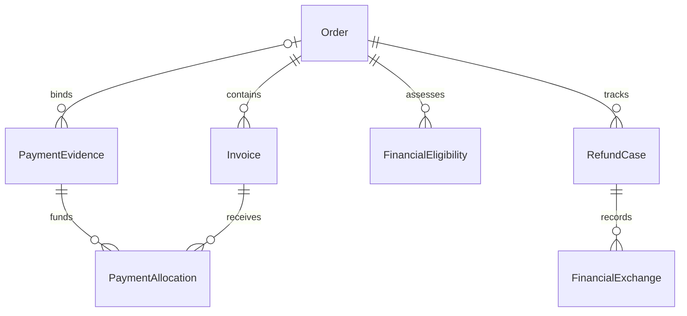

# U4 대금·배분·환불 기능 명세

## 목적과 적용 범위

[통합 확인한 답변](functional-design-questions.md)에 따라 첫 배포의 직원 청구·실제 입금 확인·수동 배분·정정·잔액·환불 결과를 설계한다. 본 문서가 처리 순서와 상태 전이의 단일 원본이다. 데이터 구조는 [entities.md](entities.md)의 YAML, 판단 규칙은 [rules.md](rules.md)의 YAML이 단일 원본이며 아래 관계/규칙 요약은 파생 뷰다. 문서 작성은 구현·성능·실거래·배포 완료를 뜻하지 않는다. [S1–S6]

이번 범위 변경은 주문당 복수 청구, 같은 주문의 제공 전·후 지급 혼합, 입금당 한 주문/그 주문 안 복수 청구 수동 배분과 네 중복 방지 장치다. 청구 명칭은 계약에 따라 표현하며 세 가지 단계 유형으로 제한하지 않는다. HW/SW 별도 주문·전체 직원 수락·FULL 제공은 유지한다. 외부 수금/자동 배분·복잡한 부분 제공·자동 연체 제재·자동 중첩 보상 계산은 후속이다.

## 소유권과 관계

다음 파생 ER 문법은 실제 Mermaid parser로 확인했다. 모델의 단일 원본은 entities.md의 YAML이다.

텍스트 관계도: 주문 하나에 청구0..여러 건, 입금 하나에 현재 주문0..1건, 입금 하나와 청구 하나 사이에는 배분 원본 여러 건이 연결된다. 주문 하나에는 목적별 대금 판단과 환불 건이 여러 개 있으며 환불 건은 원래 금융 작업/실제 결과를 참조한다. 입금·배분·환불은 FinancialSettlement만 변경한다. 계약·총액은 CommercialAgreement/OrderAcceptance, 실제 HW/SW 완료·회수는 각 이행 소유자, 후속 허용은 AfterSalesDecision의 원본을 읽는다.

## 약정과 금액 보존

### 주문대금·지급 약정·청구

- T는 U3의 현재 승인된 주문 총액이다. 유효 계획의 각 지급 의무 O에는 주문 내 불변 obligationKey와 명칭·확정 원 단위 금액·지급 조건·기한 근거·제공 전 필수 여부를 고정한다. 계획 전체 의무 합계는 T와 같아야 완전하다.
- 계획 초안/누락·미확인과 유효 계획을 구분한다. 원문 계약 설명을 자동 해석해 누락된 금액·날짜·필수 여부를 만들지 않는다. 비율 약정도 첫 버전의 청구에는 직원이 확인한 정확한 원 단위 금액과 산정 근거를 보존한다. 임의 비율 반올림 산식을 새로 도입하지 않는다.
- 청구는 계획 의무에 대한 지급 요청이다. 현재 의무별 유효 청구는 하나이며 주문에는 여러 청구를 순차 또는 함께 등록할 수 있다. 명칭은 빈 설명을 허용하지 않는 자유 텍스트다. 청구의 금액·조건·필수 여부는 승인 계획과 같아야 한다.
- 아직 발행하지 않은 의무도 선행 지급 판단에 포함한다. 청구를 발행하지 않았다는 이유로 필수 지급액이0이 되지 않는다. 요청 기록인 ISSUED와 이메일 전달·실제 지급은 별개다.
- 미발행 의무가 있으면 청구 합계가 T보다 작을 수 있다. 전체 계획은 항상 T와 대조하고, 현재 청구 합계는 T를 넘을 수 없다. 정정/취소된 옛 청구를 새 청구와 중복 합산하지 않는다.
- U3 승인 변경이 필요하면 기존 계획·청구·배분을 보존한 채 변경 원본을 받아 재대조한다. 같은 의무의 청구 정정은 obligationKey/원래 invoiceId에 결합한다. 청구 새로 만들기로 이미 지급된 의무를 다시 받지 못한다.
- 수동 갱신에는 WF4.8의 별도 갱신 주문을 사용한다. T와 계획 합계는 그 갱신 주문의 승인 총액이며 원래 구매 주문의 금액/지급을 새 회차 금액과 섞지 않는다. 회차별 주문 하나에 여러 청구를 둘 수 있고 기존 입금당 한 주문 제약도 그대로 적용한다.

### 입금·배분·환불 잔액

다음은 논리 금액 식이며 저장 기술을 정하는 코드가 아니다. 확인되고 현재 유효한 실제 입금 p에 대해:

| 기호 | 정의 |
| --- | --- |
| P | 확인된 실제 입금 원금 |
| L | 현재 배분 원금 합계. 해당 배분에서 이미 환불한 원금도 원래 귀속으로 남긴다. 정정 취소는 별도 효과로 반영한다. |
| RA / RU | 각각 배분에 귀속한 확정 환불액 / 미배분 원금에서 확정 환불한 금액 |
| A | 현재 순배분액 = L − RA |
| U | 아직 배분·환불되지 않은 잔액 = P − L − RU |
| HA / HU | 각각 배분 원금 / 미배분 원금에 귀속한 진행·결과 불명 환불 예약액 |

정상 확정 상태에서 `P = A + U + RA + RU`, `A >= HA >= 0`, `U >= HU >= 0`이다. 새 배분의 입금 가용액은 `U − HU`이며 환불 예약액은 배분 가능 현금이 아니다. 청구별 순지급액은 해당 청구의 `L − RA` 합계이고 새 배분액은 현재 청구액에서 순지급액을 뺀 금액을 넘을 수 없다. 같은 입금이 여러 청구에 나타나도 주문의 실제 입금 합계에는 P를 한 번만 센다. 청구액·입금액·배분액·환불액을 같은 합계에 더하지 않는다. [BR4.7–BR4.10]

환불 성공 시 해당 예약을 줄이고 RA 또는 RU를 같은 변경에서 증가시킨다. 배분 원금 환불은 순지급액 A를 줄이지만 U를 늘리지 않는다. 이미 환불했거나 예약된 배분 원금을 취소하여 U로 되돌릴 수 없다. 배분 정정으로 L을 줄일 수 있는 범위는 그 배분의 확정 환불액과 예약액을 제외한 원금뿐이다.

모든 환불 건은 주문 및 원래 입금별 공통 잔액을 대조한다. 새 환불 예약은 해당 지급 원금의 남은 환불 가능액과 U7 승인 한도의 잔액 중 작은 범위를 넘지 않는다. 승인 한도는 같은 승인 판단을 소비한 다른 환불 건의 확정/예약액도 뺀다. 개별 RefundCase마다 원래 한도를 복제하여 재사용하지 않는다.

취소·할인·조건 정정은 U3 승인 계획/청구 개정으로 관리한다. 실제 환불 기록만으로 주문 총액을 줄이거나 취소된 청구의 미수금을 새 연체로 만들지 않는다. 금액이 대조되지 않으면 남는 금액을 자동 지급·다른 주문 배분·추가 환불하지 않고 대조 대상으로 둔다.

외부에서 이미 발생한 초과 환불 등 불일치 사실을 발견하면 원본 근거를 보존하여 DISPUTED/대조로 표시하고 관련 신규 소비를 막는다. 사실을 숨겨 식을 맞추거나 정상 지급 완료로 처리하지 않는다. 실제 원금 부족의 처리에는 별도 합의·운영 판단이 필요하다.

## 처리 흐름

### WF4.1 계약 지급 약정과 복수 청구

1. 직원이 현재 기업/조직·대금 등록 권한·직원망·MFA를 확인한다. 고객은 허용 범위의 조회만 수행한다.
2. U3의 승인 계약 개정·원래/현재 주문 조건·T·동일 HW/SW 타입·FULL 조건을 읽는다. 주문 수락 전 계획 초안은 보존할 수 있지만 유효 청구/제공 판단으로 사용하지 않는다.
3. U3의 지급 계획에 지급 의무들을 입력·합의 근거에 연결한다. 등록자와 다른 사람의 계약 승인이라는 기존 절차를 통과해야 유효하다. U4 담당자가 지급분을 바꿔 승인/고객 합의를 우회할 수 없다.
4. T와 의무 합계, 모든 조건·기한 근거·제공 전 필수 여부 및 계획 개정을 대조한다. 불명확하면 직원 확인 대상으로 남긴다. 전액 후불의 제공 전 의무 없음은 명시된 빈 집합이며 미확인과 다르다.
5. 직원은 각 의무의 청구를 등록한다. 같은 obligationKey의 현재 유효 청구·원래 정정 관계·금액을 확인하고 청구 원본과 이력/후속 사실을 기록한다.
6. 실제 입금이 없는 한 지급액을 증가시키지 않는다. 고객에게 허용된 청구·기한·남은 조치를 제공한다. 발송 요청과 실제 이메일 전달은 별개다.

### WF4.2 실제 입금 확인과 중복 등록 차단

1. 직원이 실제 입금 출처·원문 참조·원금·시각·대상을 확인한다. 미확인 후보도 REVIEW로 기록할 수 있으나 확정 지급 합계에 넣지 않는다.
2. 실제 수취 원본에서 검증한 source profile에 따라 원래 거래 식별과 별칭을 대조한다. 계좌·거래 ID의 비교 규칙은 원본에 따르며 기업/주문/요청 키를 중복 식별 차원에 넣지 않는다. 프로필 개정이나 입력 채널이 달라도 같은 실제 거래는 동일 정규 원본에 결합하며, 프로필 버전 자체로 중복 검사 범위를 나누지 않는다. 정규화 변경은 구/신 식별 별칭을 함께 예약하여 기존 거래를 다시 등록하지 못하게 한다.
3. 식별 부족·이미 등록됐을 가능성·금액/대상 불일치는 대조 건으로 보존한다. 다른 캡처·새 파일 해시·직원의 신규 UUID는 다른 거래라는 증거가 아니다. 근거 없이 직원이 확인 버튼만 눌러 우회하는 경로는 두지 않는다.
4. 검증된 거래 식별을 유일하게 예약하고 PaymentEvidence 확정/원본·이력·요청 결과·후속 사실을 하나의 원자적 변경으로 기록한다. 경합 요청은 기존 거래를 대조하며 신규 현금 효과를 만들지 않는다.
5. 기존 공통 접수·보호 저장 확인을 통과한 후 원래 접수/결과를 반환한다. 실패/결과 불명은 원래 키로 재확인한다. 동일 실제 거래의 다른 요청 키도 BR4.5로 차단한다.
6. 전역 중복이 다른 기업 원본과 충돌하면 권한 있는 대조가 필요하다는 안전한 사유만 반환한다. 다른 기업의 이름·금액·주문·계좌를 응답에 담지 않는다.

### WF4.3 한 주문 내부의 청구별 수동 배분

1. 직원이 입금 및 모든 대상 청구의 현재 권한·기업·조직·주문과 정확한 개정을 확인한다. CONFIRMED가 아닌 입금·유효하지 않은 청구는 배분하지 않는다.
2. 한 명령에서 직원이 같은 주문의 청구별 금액을 명시한다. 미연결 입금은 이 주문에 결합하며 이미 다른 주문에 연결돼 있으면 거절한다. 같은 주문에 여러 입금이 들어오는 것은 허용한다.
3. 입금·정렬된 청구 원본·환불 예약의 공통 동시성 경계를 확보하여 현재 잔액을 다시 대조한다. 선행 조회 결과나 요청 키 하나만으로 잔액 보호를 대체하지 않는다.
4. 각 청구 잔액 및 입력 전체 합계가 가용 입금액 안에 있는지 확인한다. 하나라도 실패하면 전체 배분을 적용하지 않는다. 잔액을 자동으로 다른 청구/주문에 보내지 않는다.
5. 배분·연결·정정 관계·이력·대금 재판단에 필요한 사실을 원자 기록한다. 입금 원본 P를 중복 증가시키지 않으며 보호 저장 확인 후 성공 응답한다.
6. 고객/직원 조회에 청구별 순지급액·잔액, 주문별 실제 입금/미배분/환불 상태를 구별해 제공한다. 배분 완료로 출고·발급 완료를 생성하지 않는다.

### WF4.4 정정·취소와 재대조

1. 직원은 원래 기록과 정확한 개정, 수정 사유·실제 근거를 지정한다. 대상과 원래/새 주문 모두에 현재 권한이 있어야 한다.
2. 순수 입력 정정, 잘못된 실제 입금 확인, 배분 오류, 계약 조건 변경을 구별한다. 계약 조건 변경은 U3 승인·동의/적용 경로로 보낸다. 환불은 입금 사실 정정이 아니다.
3. 영향을 받은 이행/환불 진행·미확인 결과·이미 소비한 원금을 대조한다. 이미 환불한 금액·진행 중 예약은 해제하지 않는다. 실제 이행을 원본 정정만으로 취소했다고 표시하지 않는다.
4. 배분 정정은 원래 효과를 한 번 상쇄하고 새 효과를 같은 변경에서 추가한다. 잘못된 주문 연결을 바꾸려면 기존 순배분·예약이 안전하게 해소되고 관련 진행 상태가 대조돼야 한다. 한 시점에 두 주문의 유효 연결을 남기지 않는다.
5. 거래 식별 정정은 원래 식별/별칭 예약을 보존한다. 같은 은행 거래를 새 PaymentEvidence로 복제하지 않는다. 실제 다른 거래였음이 확인된 경우도 원래 정정 관계와 별개 실거래 식별을 보존한다.
6. 확인된 새 원본으로 현재 지급·기한·제공 자격을 재판단하고 관련 소비자에게 정정 사실을 전달한다. 미해결 충돌은 영향받은 추가 처리만 보류한다.

### WF4.5 제공 전 필수 지급분과 수락/제공 판단

1. 호출자는 `SALE_ACCEPTANCE` 또는 `PROVISION` 목적과 주문·전체 품목·현재 계획 개정을 명시한다. 목적 누락/불일치는 미확인으로 반환한다.
2. 수락 목적은 유효 계약·대금 조건의 확인과 현재 적용 가능한 제한을 대조한다. 청구나 입금이 아직 없다는 이유만으로 수락을 무조건 막지 않는다. U3의 공급 가능성·납기 등 다른 수락 조건은 그대로다.
3. 제공 목적은 전체 계획의 제공 전 필수 의무를 고른다. 의무 누락·미승인·불명확·관련 충돌은 UNVERIFIED/HOLD이며 명시적 빈 집합만 선행 지급 없음이다.
4. 각 필수 의무의 유효 청구/배분과 정정·환불을 대조한다. 청구 미발행은 지급 의무 면제가 아니다. 필요한 순지급액을 모두 충족해야 대금 조건 ALLOW를 낼 수 있다. 계약상 제공 후 지급분은 선행 필요액에 더하지 않는다.
5. 해당 판단은 목적·계약·계획·입금/배분·제한의 개정과 함께 반환한다. U5/U6는 실행 직전에 현재성을 재확인하고 다른 권한·재고/발급·전체 준비 조건을 확인한다. 과거 ALLOW를 저장해 영구 출고 허가로 사용하지 않는다.
6. FULL 주문의 일부 품목/지급분만 확인돼도 전체 실행을 허용하지 않는다. 실제 출고/발급의 성공·실패·결과 불명은 각 이행 소유자가 기록한다.

예시: T=1,000만원, 첫 의무200만원은 제공 전 필수, 나머지800만원은 수령 후30일 약정이다. 200만원 확인·배분으로 대금 선행 조건을 충족할 수 있으나, 그때도 전체 HW 준비 등 다른 제공 조건은 별도 확인한다. 800만원의 기한은 실제 약정 기산 사실 전에는 미확인이다. 청구 명칭으로 이 결정을 추정하지 않는다.

### WF4.6 후불 기한·정정·수동 제한

1. U5/U6가 확인한 실제 제공 완료 원본의 주문·품목·수량·완료 기준·실제 시점·원래 제공 건 식별/개정을 읽는다. 외부 요청 접수·출고 시도·조기 SW 설치만으로 완료를 만들지 않는다.
2. 실제 완료일 기산을 합의한 지급분이면 완료 시점의 한국 날짜에 합의한 N 달력일을 더한다. 예를 들어12월1일+30일은12월31일이며 그날까지 허용한다. 월말·윤일·연말도 달력 날짜 연산을 사용한다.
3. 다른 고정 날짜나 확인 사건에 따른 청구는 그 약정만 적용한다. 지원하지 않는 휴일/영업일·기산 사실 미확인은 직원 확인 대상으로 둔다. 미제공 잔량이나 부분 완료를 FULL 완료로 간주하지 않는다.
4. 중복/역순 완료 사실은 원래 제공 건과 개정으로 대조한다. 확인된 높은 개정의 정정은 같은 산식으로 재계산하고 전후를 보존한다. 현재 합의 변경이 필요한 경우는 U3로 보낸다.
5. 확정 기한의 다음 한국 날짜부터 확인된 미지급 잔액을 지연 후보로 표시한다. 원본 조회 실패·근거 충돌은 지연으로 단정하지 않는다.
6. 직원이 실제 지연·계약의 적용 대상/행위·현재 근거를 확인해 제한/해제를 기록한다. 자동 회수·기간 단축·무관 업무 차단은 실행하지 않는다.

### WF4.7 실제 환불과 부분 실패

1. U7의 승인된 후속 판단·대상·정확한 한도/개정과 원래 주문/입금·배분을 읽는다. 계약상 회수가 선행돼야 하면 U5/U6의 실제 회수 결과를 읽는다. 회수 필요 여부 자체가 불명확하면 보류한다.
2. 주문·원래 입금·공통 승인 한도의 현재 환불 예약/확정액을 대조하고 허용 금액을 예약한다. 동시에 생성한 다른 환불 건도 같은 원금을 소비한다.
3. 요청 기록과 실제 자금 이동은 구별한다. 첫 버전은 직원이 외부 실제 처리와 원래 작업 참조를 확인해 결과를 등록하며 OMS가 금융망을 실행하지 않는다.
4. 부분 성공은 확인된 부분만 RA/RU로 확정하고 잔여 예약·실패·불명을 나눠 보존한다. 결과 불명은 원래 작업 조회/직원 대조를 우선하며 실패로 바꿔 새 작업을 만들지 않는다.
5. 실패/미실행이 확인된 부분은 예약을 해제할 수 있다. 실패 원인 해소와 현재 한도/권한 재확인 후 그 부분만 새 시도로 예약한다. 성공분·불명분을 포함한 전체 재시도는 금지한다.
6. 동일 결과의 반복·역순·정정은 원래 작업과 실제 거래 식별로 대조하고 중복 환불하지 않는다. 실제 완료 원본과 이력을 함께 기록한 뒤 고객에게 허용된 진행/남은 조치를 제공한다.

부분 결과는 금액별 portionKey와 원래 작업/현재 시도에 결합한다. 같은 부분의 현재 시도에서 확정 성공·확정 실패/미실행·불명·진행 대기 금액의 합은 그 부분 대상액과 같다. 실패한 부분의 재시도는 그 부분의 새 현재 시도를 만들고 옛 실패 시도는 이력으로만 남긴다. 재시도 금액을 새 환불 목표액으로 더하지 않으며 미확인 부분에 새 실행 시도를 만들지 않는다.

RefundCase 상태는 현재 부분 결과를 집계한다. 정정 대조 중이면 RECONCILING, 목표액 전부 확정 성공이면 COMPLETED, 일부 성공과 미완료가 함께 있으면 PARTIAL이다. 성공액0에서 불명이 있으면 UNKNOWN, 불명 없이 실제 진행/예약이 있으면 IN_PROGRESS, 전부 명확한 실패/미실행이고 활성 예약이 없으면 FAILED다. 실행 전은 REQUESTED, 미실행을 확인해 명시적으로 취소한 경우만 CANCELLED다. 상태를 직접 지정하여 금액/예약을 바꾸지 않는다.

7. **같은 작업의 뒤늦은 확인:** 100원 목표 중60원 성공·40원 불명은 확정60·예약40·PARTIAL이다. 원래 작업의40원 성공을 추가 확인하면 새 실행 없이 예약40을 확정으로 옮겨 확정100·예약0·COMPLETED로 집계한다.40원 미실행/실패가 확정되면 예약만 해제하고 PARTIAL을 유지하며, 원인 해소 뒤 그40원만 새 시도로 예약할 수 있다.
8. **완료 결과의 정정:** COMPLETED에서 입력 오류/상충 근거가 제시되면 RECONCILING으로 두고 원래 소비 보호와 관련 신규 처리 보류를 유지한다. 확인되지 않은 주장만으로 확정 환불액을 줄이거나 가용액을 늘리지 않는다. 같은 원래 작업/실제 거래의 높은 확인 개정으로만 정정 전후 차이를 원자 반영한다. 확정 환불을 불명으로 정정하면 줄인 RA/RU와 같은 금액을 HA/HU로 옮겨 가용 현금을 늘리지 않는다. 명확한 미실행/실패로 정정된 부분만 소비를 해제한다. 정정이 다른 배분·예약·공통 한도와 충돌하면 정상 상태로 만들지 않고 대조/보류한다.
9. 정정 후 부분별 결과에서 상태를 재집계한다. 예를 들어100원 완료 기록이 실제60원 성공·40원 불명으로 확인 정정되면 확정60·예약40·PARTIAL이며, 나중에 원래 작업40원 성공을 확인하면 다시 COMPLETED다. 모든 결과 개정과 정정 관계를 남기며 원래 작업 식별·거래 유일성 보호는 유지한다.

### WF4.8 수동 갱신 회차별 대금

1. U6가 원래 기업·SW 권한·현재 수동 갱신 회차·요청 근거를 소유한다. 원래 구매 주문 참조와 회차 식별/개정을 제공하며, U4가 회차를 임의 생성하지 않는다. 자동 갱신 신청/실행은 후속 범위를 유지한다.
2. U3는 그 회차에 대한 별도 SW 갱신 주문을 기존 주문 흐름으로 생성/대조한다. 원래 주문/권한과 renewalCycleRef를 명시하고, 회차 식별을 주문 생성의 안정된 업무 키로 사용한다. 같은 기업·회차는 항상 같은 갱신 주문을 재확인하며 요청 키·계약 개정이 바뀌어도 두 갱신 주문을 만들지 않는다. 원래 주문 스냅샷·기지급 상태는 보존한다.
3. U3가 그 갱신 주문의 정확한 가격·지급 계획·승인 계약·필요 제안/고객 동의를 보존하고 전체 직원 수락을 수행한다. 합의 밖 가격을 현재 상품 가격으로 채우지 않는다. U3와 U6의 주문/회차 결합은 원래 식별과 지속 사실로 대조하며 결합 미확인 중에는 청구/실제 갱신 자격을 확정하지 않는다.
4. U4는 그 갱신 주문과 정확한 회차 하나를 청구의 renewalCycleRefs에 함께 보존한다. 배분은 그 주문의 청구에만 연결하며 대상 청구·배분·대금 자격의 회차가 일치해야 한다. 과거 주문에 이미 연결된 입금은 새 갱신 주문에 재사용할 수 없다. 같은 회차 중복 요청/결과는 기존 청구/배분/판단을 재확인한다.
5. 갱신 PROVISION 판단은 해당 갱신 주문의 현재 승인 계획·회차·실제 입금/배분·현재 유예/제한 근거를 대조한다. 과거 구매나 이전 회차의 PAID/ALLOW는 새 회차 충족이 아니다. 현재 회차의 선지급 미충족은 HOLD다. 명시적 유효 유예가 있다면 U6는 그 별도 합의 근거로 임시 이용을 판단하며 지급 완료로 표시하지 않는다. 유예 기간의 자동 계산·중첩 자동화는 이번 범위를 확대하지 않는다.
6. U6가 실제 갱신 기간/발급 적용 결과를 소유한다. U4의 청구·지급 확인만으로 실제 기간을 변경하지 않는다. 고객/직원 조회는 원래 주문, 갱신 주문, 대상 회차, 지급/미지급, 실제 적용/미확인과 남은 조치를 구별한다. 기존 주문/회차의 정정이 새 회차를 자동 취소하거나 이중 청구하지 않도록 원본 연결로 재대조한다.

## 상태 전이

금액 충족과 사실 확인을 분리한다. 아래 상태는 엔티티 내부 논리 상태이며 C00의 Receipt/Knowledge 및 외부 실행 결과 enum을 바꾸지 않는다.

| 원본 | 허용 전이 | 선행 조건과 금지 |
| --- | --- | --- |
| Invoice | DRAFT→ISSUED | 승인된 계획 의무와 일치·현재 권한·동일 의무 유효 청구 없음 |
| Invoice | DRAFT→CANCELLED, ISSUED→SUPERSEDED/CANCELLED | 명시된 정정/승인 근거·연결 배분/환불 영향 대조. 옛 원본 보존. 새 개정은 별도 원본 개정으로 연결 |
| Invoice 지급 파생 상태 | UNPAID/PARTIAL/PAID 또는 REVIEW | 순지급액과 현재 청구액으로 산출. 근거 충돌이면 PAID 대신 REVIEW. lifecycle을 지급 상태로 재사용하지 않음 |
| PaymentEvidence | REVIEW→CONFIRMED | 검증된 실제 거래 식별·금액·원본·확인자. 단순 첨부/참조 생성으로 전이 불가 |
| PaymentEvidence | CONFIRMED→DISPUTED | 근거 충돌 기록·관련 신규 소비 보류 |
| PaymentEvidence | DISPUTED→CONFIRMED/REVERSED, CONFIRMED→REVERSED | 직원의 확인 근거·잔액/이행/환불 영향 대조·원본/식별 보존. REVERSED를 실제 환불로 표현하지 않음 |
| PaymentAllocation | APPLIED→REVERSED | 원래 효과를 한 번만 상쇄·환불/예약 귀속 보호. 새 배분은 새 원본으로 연결 |
| RefundCase | REQUESTED→IN_PROGRESS | 한도 예약, 원래 외부 작업/담당자 연결. 요청이 곧 외부 실행 아님 |
| RefundCase | IN_PROGRESS→UNKNOWN/PARTIAL/COMPLETED/FAILED | 실제 근거에 따라 부분별 결과. UNKNOWN 예약 유지, FAILED는 미실행/실패가 확인된 부분만 |
| RefundCase | UNKNOWN→IN_PROGRESS/PARTIAL/COMPLETED/FAILED | 같은 원래 작업의 확인 결과. 새 지급 실행으로 UNKNOWN을 해소하지 않음 |
| RefundCase | PARTIAL/FAILED→IN_PROGRESS | 실패분의 원인 해소·새 시도·현재 한도 대조. 성공/불명분은 재실행 불가 |
| RefundCase | PARTIAL→PARTIAL/COMPLETED | 같은 원래 작업의 미확인 부분을 추가 조회·확인. 새 실행 없이 HA/HU에서 RA/RU로 옮기거나 명확한 실패분 예약만 해제하여 재집계 |
| RefundCase | COMPLETED/PARTIAL/FAILED/UNKNOWN/IN_PROGRESS/CANCELLED→RECONCILING | 원래 결과의 오류·상충 근거 제시. 기존 소비 보호·신규 의존 처리 보류, 식별/과거 개정 보존 |
| RefundCase | RECONCILING→COMPLETED/PARTIAL/UNKNOWN/IN_PROGRESS/FAILED/CANCELLED | 확인된 높은 결과 정정 개정으로 부분별 결과·공통 한도·RA/RU/HA/HU를 원자 대조하고 WF4.7의 집계 조건으로만 전이. 실제 미실행 확인 없는 예약 해제 금지 |
| RefundCase | REQUESTED→CANCELLED | 실제 미실행 확인 후 예약 해제. IN_PROGRESS/UNKNOWN의 임의 취소는 불가 |

그 밖의 전이는 거절/현재 원본 재조회로 처리한다. 오래된 expectedRevision, 취소와 배분의 경합, 확인과 환불의 경합을 마지막 쓰기 우선으로 해결하지 않는다.

## 계약 변경과 기존 동작 호환

기존 C00·C04–C06·C16–C20의 닫힌 필드/enum을 그대로 둔 채 새 기능이 전달된다고 가정하지 않는다. 변경 계약의 논리 이름은 `u4-financial-v1`로 분리하고 기존 공통 Money/Ref/Receipt/Problem/TargetScope 의미를 재사용한다. 실행 호스트/서비스 구조는 기존 것을 사용하며 새 독립 배포 서비스를 요구하지 않는다. 실제 스키마 파일 작성과 기존 코드 수정은 Code Generation의 계획·검증 대상이다.

| 경계 | 현재 계약의 부족 | 변경 계약의 필수 내용/호환 |
| --- | --- | --- |
| C04 승인 계약 / C05 구매 조건 | 기존 paymentMode는 PREPAY/POSTPAY만 표현. approved terms에는 주문의 복수 지급 의무가 없음 | U3 소유의 AgreedPaymentPlan과 개정·원래 승인/동의 참조를 추가. 혼합은 새 계약에서 명시적으로만 표현. 수동 갱신 주문의 원래 주문/권한·renewalCycleRef와 회차별 안정 생성 키도 보존. 기존 주문을 혼합/갱신 주문으로 자동 변환하지 않음 |
| C06 청구 등록 | FinancialEvidenceInput은 금액/근거만 있고 label·의무·기한·제공 전 필수 여부를 직접 표현하지 못함 | registerInvoice는 orderRef·구매 조건/계획 개정·obligationKey·label·amount·DueBasis·근거·정정/요청 식별을 명시. 기존 renewalCycleRefs는 보존하여 갱신 주문/회차와 대조하며 필수 여부는 승인 의무에서 읽어 검증 |
| C06 입금 확인 | externalReference만으로 수취 원본별 거래 식별/별칭·정정 이력을 표현하지 못함 | recordPaymentEvidence는 source profile 개정·수취 원본·거래 식별·실제 시각·금액·확인 근거·기업 범위·원래 정정/요청 식별을 보존. 증빙 원문을 임의 외부 Ref로 위장하지 않음 |
| C06 배분 | AllocationInput은 청구 하나 입력이며 다건 명령의 전체 원자성을 명시하지 않음 | allocatePaymentBatch는 한 paymentEvidenceRef·한 orderRef·청구별 양의 금액/개정·판단 근거·요청 식별을 갖고 전체 검증/전체 기록. 수동 갱신의 renewalCycleRefs를 유지하며 청구/갱신 주문과 대조. 기존 단건 호출은 새 모델의 단일 항목으로 대조 |
| C06 대금 자격 | EligibilityInput/View에 수락/제공 목적·계획 개정이 없음 | 목적·계약/계획 개정·모든 판단 근거 개정을 새 계약에 결합. 기존 renewalCycleRefs는 유지하고 갱신 주문·해당 회차와 대조. 구버전 호출은 목적을 추정하지 않고 명시적인 소유자 어댑터에서 호출 의미를 확인하거나 HOLD |
| C16 고객 대금 조회 / C17 직원 조회·명령 | 기존 FinancialView는 청구별 금액/기한은 있으나 명칭·계획/조건·잔액 구분·안전한 미확인 설명이 부족 | 허용된 청구 명칭/금액/기한·순지급/잔액·미배분·환불·현재성·남은 조치를 반환. 고객에는 은행 거래 원문/다른 기업 중복 원본을 제외. 목록·상세·합계·이력 동일 범위 |
| C20-E14/E20/E21/E22 | 일반 Fact의 sourceRef만으로 새 계획·판단 목적 의미를 추정하면 위험 | 원래 factId·owner·대상·개정·새 계약 참조로 통지하고 소비자는 현재 원본을 읽음. 청구/입금/대금 ALLOW를 실제 제공 완료로 해석하지 않음 |
| C07/C08, E25/E29 | 기존 제공 완료 원본 계약은 유지 | U4는 소유자·trancheId·품목·수량·완료 기준·actualCompletedAt·sourceRevision·correctionOf를 대조. FULL만 첫 버전 실행하며 미완료/부분 원본은 합성 완료로 만들지 않음 |
| C09/E37, C22 | 후속 허용/실제 환불의 출처·한도·원래 작업 대조 필요 | U7 판단과 실제 회수·직원 확인 결과를 연결. 외부 수금/자동 환불 실행은 후속이며 미등록 주체를 CONFIRMED로 등록하지 않음 |

U3는 이 변경이 필요한 공통 계약과 주문 제출·직원 수락·조건 변경의 검증을 수정해야 한다. 최초 PREPAY/POSTPAY 주문의 원래 스냅샷은 보존하고, 기존 주문의 새 혼합 계획은 정식 합의·승인·필요 고객 동의로만 적용한다. 기존 U3의 모든 혼합 거절 테스트를 삭제하지 않는다. 구버전/미지원 입력 거절 회귀는 유지하고 새 승인된 혼합 경로의 수락·제공 전 필수분·후불 잔액 회귀를 추가한다.

U3의 상품 목록 접근 문제 및 U2의 기존 미해결 위험은 별도다. 이 설계로 그 위험을 해소하거나 과거 승인·검증 결과를 변경하지 않는다.

## 실패·보안·화면 경계

| 조건 | 처리 |
| --- | --- |
| 세션 만료/권한 회수/직원망 불충족 | 저장/조회 시 현재 권한 확인, 안전한 거절. 재로그인 후 원래 요청 재조회. 다른 기업 원본 반환 없음 |
| 원본/보호 저장 불가·디스크 부족·중간 종료 | 성공 접수 금지, 원래 요청 상태로 재확인. 반쪽 배분이나 원본만 있는 성공을 반환하지 않음 |
| 동일 실제 거래를 두 주문에 동시 신규 등록 | 원본 거래 유일성과 한 주문 결합을 기록 시점에 보호. 한 건만 신규 효과를 가짐 |
| 서로 다른 입금을 같은 청구 잔액에 동시 배분 | 청구의 공통 잔액도 보호하여 초과 순지급을 막음 |
| 원래 입금/계획 정정과 배분/환불 경합 | 개정과 공통 잔액을 재대조. 오래된 명령은 충돌/재확인 |
| 요청 키 재사용·새 키의 업무 중복 | 같은 키 다른 내용은 충돌, 다른 키 같은 실제 거래는 업무 식별로 차단 |
| 입력 텍스트·증빙 설명의 마크업/긴 문자열 | 계약 명칭을 코드/조건식으로 실행하지 않음. 안전하게 표시하고 유한 입력 상한을 후속 계약에서 정의. 자동 절삭·숨은 기본값 없음 |
| 조회 실패·빈 목록·일부만 허용 | 로딩/실패/대상 없음/권한 제한 구별. 일부 합계를 기업 전체 합계라고 표시하지 않음 |
| 실제 제공자/은행 근거 미등록 | 미등록·미확인과 남은 준비를 표시. 합성 시험을 실제 입금·환불 결과로 사용하지 않음 |

U8/U9 화면은 한국어·PC1280 이상에서 청구 명칭/약정·금액·기한/미확인·지급/미배분/환불을 구별하고 상태를 색상만으로 전달하지 않는다. 자동화 설정 화면·모바일·증빙 대량 분석 서비스를 새로 추가하지 않는다. 고객 은행 증빙 제출을 첫 버전의 입금 확정 경로로 가정하지 않는다.

## 시나리오와 검증 인수인계

| ID | 상황 | 기대 결과/연결 |
| --- | --- | --- |
| VS4.1 | 임의 명칭의 복수 청구, 제공 전200/제공 후800 | 계획 합계1,000, 200 충족 후 대금 선행 조건 판단, 후불800을 선지급액에 합산하지 않음; BR4.3, BR4.11 |
| VS4.2 | 필수 의무 청구를 미발행/삭제하려 함 | 계획의 필수 의무 유지, 지급 충족 우회 불가; BR4.3, BR4.11 |
| VS4.3 | 같은 실제 입금을 다른 캡처·새 요청·다른 기업/주문으로 재등록 | 한 실제 현금만 반영, 안전한 충돌 사유; BR4.4–BR4.6 |
| VS4.4 | 한 입금을 같은 주문 청구60/40에 배분, 이어 다른 주문에 배분 | 앞의 수동 배분 허용, 다른 주문 거절, 입금 합계 한 번; BR4.6–BR4.8 |
| VS4.5 | 입금100에 각각80을 동시 배분 / 두 입금이 청구100에 각각80 배분 | 입금/청구 어느 쪽도 가용액 초과0건, 거절 요청 재확인 가능; BR4.7–BR4.9 |
| VS4.6 | 환불40 후 배분 취소·신규 배분, 불명 환불40 후 재요청 | 확정/예약40을 가용 현금으로 되살리지 않음; BR4.7, BR4.10, BR4.18–BR4.19 |
| VS4.7 | 완료12월1일+30일, 다음날 경계, 미제공·조기 설치·낮은 개정 | 12월31일까지 허용,1월1일 후보, 미확인/역순으로 기한 생성/되돌림 없음; BR4.13–BR4.16 |
| VS4.8 | 입금 정정 후 양쪽 주문 연결·식별 재등록 시도 | 원래 식별/정정 보호, 한 현재 주문, 관련 이행 재대조; BR4.5–BR4.10 |
| VS4.9 | 같은 원금에 서로 다른 환불 사건, 부분 성공·실패·불명 | 공통 원금/한도 소비 보호, 실패분만 재처리, 성공/불명분 반복 금지; BR4.18–BR4.19 |
| VS4.10 | 다른 기업 목록·상세·합계·이력·중복 오류 조회 | 원본과 파생 정보 모두 차단, 거래 존재 누출 없음; BR4.1, BR4.21 |
| VS4.11 | 저장 후 응답 유실·중복 사실·배포 중 버전 혼재 | 원래 결과 재확인, 중복 효과 없음, 변경 계약 미지원은 안전한 거절/HOLD; BR4.9, BR4.22 |
| VS4.12 | 환불100 중60성공+40불명 뒤 같은 작업40성공 확인 | PARTIAL→COMPLETED, 예약40만 확정으로 이동, 신규 환불 실행0건; BR4.19, BR4.24 |
| VS4.13 | 환불100 완료 기록을60성공+40불명으로 확인 정정한 뒤40성공 확인 | COMPLETED→RECONCILING→PARTIAL→COMPLETED, RA/RU·HA/HU·공통 한도 원자 변경, 가용액 일시 증가/중복 지급 없음; BR4.10, BR4.24 |
| VS4.14 | 이전 회차 지급 완료 뒤 새 수동 갱신 회차 생성/중복/다른 회차 청구 | 회차별 갱신 주문 하나, 해당 회차 참조 일치만 허용, 과거 주문 PAID 재사용 불가; BR4.23 |
| VS4.15 | 현재 수동 갱신 미지급·과거 회차 ALLOW·회차 결합 미확인 | 현재 지급 조건 미충족/미확인으로 HOLD. 유효 계약 유예는 U6의 별도 근거, 실제 갱신/지급 완료로 표시하지 않음; BR4.11, BR4.23 |

이 표는 이후 단위·통합·PC 검증의 설계다. 현재 실행 결과가 아니다. 금융 원본 식별과 DB 동시성은 합성 모델만으로 검증 완료를 주장하지 않으며 실제 저장 경로에서 회귀해야 한다. 대량 부하·재해 복구 전수 실증·AWS 실제 배포는 이번 설계 범위를 넘지 않는다.

## 후속 범위와 추적

원래 U4 주 책임8개 스토리·26개 수락 기준을 [traceability.json](traceability.json)에 보존한다. 외부 자동 수신·자동 배분·여러 제공 건의 부분 기한·보상 자동 계산과 자동 제재 전체 시나리오는 Deferred로 남긴다. 현재 규칙이 그 안전 경계를 보존하더라도 전체 AC를 구현/검증했다고 표시하지 않는다.

주 책임26개에 더해 스토리 연결표에서 U4가 협력하는147개 AC도 추적한다. 협력 AC의 `N/A`는 그 **전체 AC의 U4 단독 완성**이 적용되지 않는다는 뜻이다. U4의 기여까지 불필요하다는 뜻이 아니며 각 행의 주 책임 Unit·협력 흐름·design_rules를 함께 읽어야 한다. 협력 AC를 U4의 전체 `OK`로 승격하지 않는다. 주 책임26개와 협력147개, 총173개를 중복 없이 구분한다.

| 협력 경로 | U4의 기여 | 전체 결과의 주 책임 |
| --- | --- | --- |
| 기업·직원 역할·MFA | 현재 대금 행위·대상 범위 검증, 민감 근거 분리 | U2 |
| 주문 수락·확인 대기·FULL | 수락/제공 목적별 대금 근거와 지급 약정 대조 | U1/U3 |
| HW 확보·출고·완료·재처리 | 현재 지급 충족/제한 제공, 실제 완료 근거 소비 | U5 |
| SW 발급·기간·갱신·회수 | WF4.8의 회차별 갱신 주문·청구/배분/자격 연결, 현재 지급 근거 제공, 기간과 금액 변경 경계 유지 | U6; 갱신 주문 U3; 고객 발급 화면 U8 |
| 변경·취소·반품·충돌 | 원래 금액/배분/환불 한도 및 실제 결과 대조 | U7; 실제 회수는 U5/U6 |
| 조합 조회·알림·직원 화면 | 권한에 맞는 원본·미확인·이력과 최소 통지 근거 | U7/U9 |
| 복구·배포·국내 저장·관측 | 원래 접수·업무 식별·보호 기록/이력 및 대조 가능성 | U10; 이력 조합 조회 U7 |

협력 경계의 존재로 자동 갱신·부분 제공·대량 부하·전체 재해 복구를 첫 배포에 새로 포함하지 않는다. 관련 AC의 전체 실증은 해당 주 책임 Unit과 첫 배포 실행 계획이 결정한다.

## 규칙 요약

| 규칙 | 요약 |
| --- | --- |
| BR4.1–BR4.3 | 권한·금액·계약 지급 약정과 복수 청구 |
| BR4.4–BR4.10 | 실제 입금·식별·한 주문·잔액·경합·정정 |
| BR4.11–BR4.12 | 제공 전 필수분과 수락/제공 목적 |
| BR4.13–BR4.17 | 약정별 기한·정정·충돌·직원 제한 |
| BR4.18–BR4.22 | 환불 한도·결과·후속 범위·이력·계약 호환 |
| BR4.23–BR4.24 | 수동 갱신 회차별 대금과 환불 결과 확인/정정 |

## Sources

- S1: [질문과 통합 확인](functional-design-questions.md), Q1–Q5·네 안전장치.
- S2: [unit-of-work.md](../../../inception/units-generation/unit-of-work.md), [unit-of-work-story-map.md](../../../inception/units-generation/unit-of-work-story-map.md).
- S3: [requirements.md](../../../inception/requirements-analysis/requirements.md) FR7–FR8·FR12–FR16, NFR4–NFR5; [원본 스토리](../../../inception/user-stories/stories.md).
- S4: [components.md](../../../inception/domain-design/components.md) FinancialSettlement와 각 인접 소유자의 경계.
- S5: [contract-summary.md](../../../inception/contract-design/contract-summary.md) C00·C04–C09·C16–C20·C22.
- S6: [첫 배포 범위](../../../release-planning/first-release-scope-proposal.md), [첫 배포 실행 계획](../../../release-planning/first-release-delivery-plan.md). 이 문서의 혼합 지급 포함은 새 Q4 B로 기존 제외 범위를 변경한다.

## Assumptions & Open Questions

- 실제 거래 source profile과 안정 식별·금융 원본 접근은 미확인이다. 확보 전 해당 실제 입금 확정 경로는 출시 준비 완료가 아니다. 후보 REVIEW 보존과 실제 지급액 반영을 구별한다.
- 새 계약 스키마·기존 U3 호환·보호 저장 재구성·물리 유일성/동시성·증빙 보관/국내 저장/권한은 이후 설계·구현의 필수 검증 항목이다. 문서상의 논리 식이 이를 대체하지 않는다.
- 기존 미해결 위험, 실제 고객 원본·은행·HW/SW·환불 실행 주체의 미등록 상태를 그대로 보존한다.
